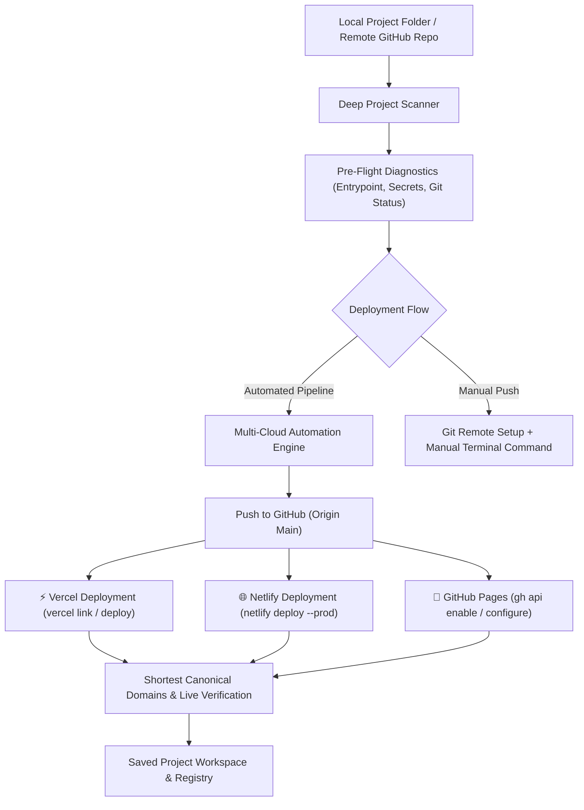

# DeployHub

<div align="center">


**The Multi-Cloud Desktop Deployment Engine for Windows**  
*Configure Git & GitHub once, customize shortest domains, and deploy simultaneously to **Vercel**, **Netlify**, and **GitHub Pages** in one click.*

[Download Latest Release (v1.2.0)](https://github.com/suvancode/DeployHub/releases/tag/v1.2.0) • [Features](#-key-features) • [Prerequisites](#-prerequisites) • [Getting Started](#-getting-started) • [Security](#-security-architecture)

</div>

---

## ⚡ Why DeployHub?

Modern web development often requires hosting projects across multiple platforms for redundancy, staging, client demos, or portfolio showcases. Configuring Git remotes, setting up GitHub repositories, linking platforms, and resolving configuration errors manually for each service is repetitive and error-prone.

**DeployHub** provides a centralized, local-first command center on Windows that connects your local folders or remote GitHub repositories to **Vercel**, **Netlify**, and **GitHub Pages** simultaneously with built-in pre-flight diagnostics, shortest domain generation, and in-app updates.

---

## ✨ Key Features

### 🚀 1-Click Multi-Cloud Deployment Pipeline
- **Deploy to All 3 Platforms at Once**: Simultaneously push code to GitHub and dispatch production builds to **Vercel**, **Netlify**, and **GitHub Pages**.
- **All 3 Enabled by Default**: Every project, wizard step, and deployment page defaults to all 3 platforms, with a `✨ Select All 3` toggle for fast re-selection.
- **Shortest Canonical Domain Preview**: Customize and preview your clean production URLs in real time:
  - ⚡ **Vercel**: `https://<slug>.vercel.app`
  - 🌐 **Netlify**: `https://<slug>.netlify.app`
  - 📄 **GitHub Pages**: `https://<owner>.github.io/<repo>/`

### 📦 Deploy Any GitHub Repo
- **Connected Account Browser**: Instant search and 1-click selection from all repositories in your connected GitHub account.
- **Paste Any URL**: Paste any public or private GitHub repository link (`https://github.com/owner/repo`).
- **Automated Workspace Sync**: Automatically clones or links the repository locally, detects entrypoints, and executes the multi-cloud pipeline.

### 🛡️ Smart Pre-Flight Diagnostics & Self-Healing
- **Root Entrypoint Verification**: Inspects for root `index.html` or build outputs (`dist/`, `build/`, `out/`) prior to deployment, preventing blank pages and 404s.
- **Vercel SSO Bypass**: Automatically configures project settings to disable team SSO login protection so deployed `.vercel.app` URLs are publicly accessible.
- **Netlify Account Verification**: Validates active Netlify CLI authentication and checks for slug availability to avoid silent deploy failures or subdomain collisions.
- **GitHub Pages Async Polling**: Monitors GitHub Pages deployment runs and performs live HTTP status checks before reporting success.

### 🔒 Choose Your Flow: Automated or Manual Push
- **Automated Pipeline**: 1-click workflow that stages, commits, pushes, and deploys across all selected providers.
- **The Manual-Push Guarantee**: Prefer terminal control? DeployHub's Manual Push tool configures remotes, runs pre-flight checks, generates the exact `git push` command for your terminal, and lets Vercel/Netlify Git integrations take over.

### 🔄 In-App 1-Click Auto-Updater
- Checks GitHub Releases automatically for new versions.
- Downloads updates in the background with a live progress bar.
- Replaces the running application seamlessly without requiring manual browser downloads or manual reinstalls.

### 🔍 Deep Local Project Scanner
- **Framework Detection**: Recognizes Next.js, Vite/React, Vue, Svelte, Astro, Nuxt, Remix, and static HTML.
- **Package Manager Detection**: Identifies `npm`, `pnpm`, `yarn`, and `bun`.
- **Sensitive Files Guard**: Scans for `.env`, `.env.local`, `*.pem`, `id_rsa`, and secrets to prevent accidental credential leakage.
- **Monorepo Awareness**: Detects pnpm workspaces, Turbo, Lerna, and nested package folders.

---

## 🏗️ Architecture



---

## 🛠️ Tech Stack

| Layer | Technology |
|---|---|
| **Desktop Framework** | Electron 33, Node.js 22 |
| **Frontend UI** | React 18, Vite 6, Tailwind CSS, Lucide Icons |
| **Language** | TypeScript 5 (Strict Mode) |
| **CLIs Integrated** | Git CLI, GitHub CLI (`gh`), Vercel CLI (`vercel`), Netlify CLI (`netlify`) |
| **Testing** | Vitest (32 Unit & Integration Tests) |
| **Packaging** | Electron Builder (NSIS Installer & Portable Executables) |

---

## 📋 Prerequisites

To use DeployHub with all deployment targets, install the following command-line tools:

1. **Git**: [git-scm.com](https://git-scm.com/)
2. **GitHub CLI (`gh`)**:
   ```powershell
   winget install --id GitHub.cli
   gh auth login
   ```
3. **Vercel CLI (`vercel`)**:
   ```powershell
   npm install -g vercel
   vercel login
   ```
4. **Netlify CLI (`netlify`)**:
   ```powershell
   npm install -g netlify-cli
   netlify login
   ```

---

## 🚀 Getting Started

### Development Setup

1. **Clone the repository**:
   ```bash
   git clone https://github.com/suvancode/DeployHub.git
   cd DeployHub
   ```

2. **Install dependencies**:
   ```bash
   npm install
   ```

3. **Run the development app**:
   ```bash
   npm run electron:dev
   ```

### Running Tests

Run the full Vitest suite (pipeline, scanner, git manager, error diagnostics):
```bash
npm run test
```

### Packaging for Production

Build the production artifacts for Windows (NSIS installer & Portable executable):
```bash
npm run dist
```
Output files will be generated in the `release/` directory:
- `DeployHub Setup 1.2.0.exe` (Windows NSIS Installer)
- `DeployHub 1.2.0.exe` (Standalone Portable)
- `DeployHub-v1.2.0-windows-x64.zip` (Portable ZIP)

---

## 🛡️ Security Architecture

1. **Local-First & Zero Cloud DB**: No external cloud database (no Supabase, Firebase, or MongoDB). All configuration is stored locally in an atomic, versioned JSON registry with corruption rollback.
2. **Context Isolation**: Renderer runs with `contextIsolation: true`, `nodeIntegration: false`, and strict IPC channels.
3. **No Shell Injections**: Child processes are executed strictly via argument arrays (`spawn`), preventing arbitrary shell string interpolation.
4. **Log Redaction**: Automatic masking of GitHub personal tokens (`gho_***`, `ghp_***`, `github_pat_***`), Vercel tokens, Netlify tokens, authorization headers, and passwords.
5. **Private By Default**: Newly initialized GitHub repositories default to Private visibility.

---

## 📦 Downloads & Releases

Check out the [Releases](https://github.com/suvancode/DeployHub/releases) tab for pre-built Windows installers.

---

## 📄 License

This project is licensed under the [MIT License](LICENSE).
